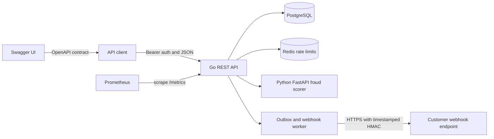

# AegisPay

[](https://github.com/manziosee/AegisPay/actions/workflows/container-security.yml)


AegisPay is a sandbox-first, multi-tenant payment infrastructure project. It provides APIs for organization identity, internal accounts and ledger entries, simulated collections and refunds, fraud review, reconciliation imports, and signed webhooks.

> **Sandbox only.** The ledger records internal platform activity; it does not represent bank-held funds or move money over a real payment network. This repository has no live payment connectors and must not be used to process real funds or cardholder data.

## Contents

- [Architecture](#architecture)
- [Technology and languages](#technology-and-languages)
- [Features](#features)
- [Run locally](#run-locally)
- [Dashboard and Netlify](#dashboard-and-netlify)
- [API quick start](#api-quick-start)
- [Services and ports](#services-and-ports)
- [Kubernetes development deployment](#kubernetes-development-deployment)
- [Operations](#operations)
- [Security boundary and production work](#security-boundary-and-production-work)
- [Repository layout](#repository-layout)

## Architecture



Docker Compose is the recommended local setup. PostgreSQL, Redis, and Fraud stay on the internal Compose network. The business dashboard includes a public product landing page and a role-aware operations workspace; it proxies authenticated API requests through the same origin. Workflows are sandbox-only and do not connect to live payment providers or move real funds. The Go API applies versioned database migrations at startup in this development setup.

The Kubernetes Kustomize base deploys the same services with single replicas and in-cluster PostgreSQL/Redis. It is a development starting point, not a production cluster design.

## Technology and languages

| Area | Technology |
| --- | --- |
| Main API and background outbox worker | Go 1.27.3, `net/http`, `pgx`, Redis client |
| Fraud scoring service | Python 3.12, FastAPI, Pydantic |
| Data and rate limiting | PostgreSQL 16, Redis 7 |
| API contract and explorer | OpenAPI 3.0.3, Swagger UI |
| Business dashboard | Next.js 16 App Router, React 19, TypeScript, Tailwind CSS v4, shadcn v4 (Radix UI), Motion |
| Dashboard delivery | Netlify adapter, standalone Docker image |
| Local infrastructure | Docker, Docker Compose |
| Cluster manifests | Kubernetes, Kustomize |
| Monitoring and security automation | Prometheus, GitHub Actions, Trivy |
| Other source/configuration languages | SQL migrations, YAML manifests/workflows, POSIX shell scripts |

## Features

- Personal or business workspace registration, sessions, member roles, and seven-day invitations accepted by the invited user account. Invitation tokens are returned once for delivery by the caller; no email service is configured.
- Bcrypt password hashes; opaque, hashed session tokens; SHA-256 hashed API keys shown once; scoped sandbox keys with optional expiration and transactional rotation.
- Optional authenticator-app TOTP MFA with encrypted factor secrets, short-lived single-use login challenges, and password-plus-code verification to disable MFA.
- Tenant-aware PostgreSQL constraints for financial records.
- Double-entry ledger postings for sandbox credits, internal transfers, simulated collection confirmation, and simulated refunds.
- Idempotency keys on financial writes, with response replay for matching retries and conflict detection when a key is reused for another request.
- Separate-user transfer approval based on per-currency organization thresholds; `TRANSFER_APPROVAL_THRESHOLD_MINOR` remains the fallback when no organization threshold is configured.
- Bank-file workflows for payment requests, multi-review payout registers, CSV statement imports, reconciliation, period close, timed reviewer delegation, and audit evidence. Payout register CSVs are for manual bank-portal entry, not executable payment files; only matching statement evidence confirms settlement.
- Fraud assessments through the FastAPI service, review cases, analyst notes, audit records, and case events.
- JSON reconciliation imports match successful collections by reference and currency, accounting for provider fees when comparing gross collection value with net settlement. Finance operators can resolve exceptions by linking a valid collection or ignoring a line, with a required note, audit event, and webhook notification.
- Outbox event dispatch to HTTPS webhook endpoints. Signing secrets are encrypted with `WEBHOOK_ENCRYPTION_KEY`; deliveries use timestamped HMAC-SHA256 signatures, bounded retries, and private-address blocking.
- Organization-scoped audit event search and manual retry for terminally failed webhook deliveries; retries are recorded in the audit log.
- Per-IP protection on registration/login and per-credential limits on authenticated API traffic; a credential bucket uses a one-way token hash rather than storing the bearer secret in Redis keys.
- Per-currency organization policy limits for single transaction size and daily collection/transfer volume, with configurable maker-checker approval thresholds.
- Cursor pagination for customer, account, collection, transfer, invitation, webhook delivery, audit, and transaction report lists.
- Unified transaction reporting across collections, transfers, and refunds, with date/type/status/currency filters, per-currency totals, and JSON or CSV export.
- Redis-backed request limits and Prometheus request counters at `/metrics`.
- A Next.js 16 business workspace with a global `Ctrl/Cmd+K` command palette, work-first overview, transaction report with a detail timeline, maker-checker approvals, a reconciliation matcher with collection search, Aegis Intelligence evaluation and review cases, multi-currency accounts, bank-file receive/send records, webhook delivery evidence with retry, a browser-local routing preview, period close controls, team access, and currency policy settings.
- Personal and business workspaces can use bank-file receive/send records without connecting a payment provider. AegisPay is the workflow and evidence layer; each user's bank remains responsible for moving funds.

## Run locally

Requirements: Docker Engine with Compose v2 and OpenSSL.

```sh
./scripts/dev-secrets.sh
docker compose up --build -d
docker compose ps
```

The secret generator creates a new `.env` file with restrictive permissions and refuses to overwrite an existing file. If an older `.env` has no webhook encryption key, generate one and append it before creating webhook endpoints:

```sh
printf 'WEBHOOK_ENCRYPTION_KEY=%s\n' "$(openssl rand -hex 32)" >> .env
chmod 600 .env
```

Do not commit `.env` or reuse development secrets in a hosted environment. `.env.example` contains placeholders only.

To stop the services while retaining local database data:

```sh
docker compose down
```

To delete the local PostgreSQL and Redis volumes as well:

```sh
docker compose down -v
```

Run the Go API unit tests and the dashboard browser workflows with:

```sh
(cd backend/go && go test ./...)
(cd apps/dashboard && npm ci && npx playwright install chromium && npm run test:e2e)
```

The browser tests use mocked API responses and do not write to the local business database.

## Dashboard and Netlify

The dashboard is a separate Next.js app in `apps/dashboard`. It serves the public landing page at `/`, authentication at `/login` and `/register`, and the protected workspace under `/app`.

It never calls the Go API cross-origin from the browser. `next.config.ts` rewrites `/proxy/:path*` to `API_PROXY_TARGET`, so the bearer token stays on the same origin:

```text
Browser -> /proxy/v1/... -> Next rewrite -> Go API /v1/...
```

For a Netlify deployment, set these environment variables in the Netlify site:

| Variable | Value |
| --- | --- |
| `API_PROXY_TARGET` | Public HTTPS base URL of the Go API, for example `https://api.example.com` |
| `NETLIFY` | `true` (switches the build away from Docker's standalone output) |
| `NODE_VERSION` | `24` |

The root [`netlify.toml`](netlify.toml) builds from `apps/dashboard`, publishes `.next`, and uses `@netlify/plugin-nextjs`. `apps/dashboard/netlify.toml` covers a Netlify site whose base directory is already `apps/dashboard`.

Do not point `API_PROXY_TARGET` at `localhost` in a hosted deployment: the Next runtime cannot reach your workstation. Deploy the Go API somewhere public, or run only the dashboard locally with Docker Compose. The CORS allow-list in the API stays scoped to Swagger UI because dashboard requests are same-origin through the rewrite.

Local dashboard development:

```sh
cd apps/dashboard
npm ci
npm run dev
# optionally: API_PROXY_TARGET=http://localhost:18080 npm run dev
```

Quality checks:

```sh
cd apps/dashboard
npm run typecheck
npm run build
npm run test:e2e
```

The workspace uses `Ctrl/Cmd+K` for navigation, actions and loaded records. Routing rules are stored in the browser only and are labelled as a preview; no live provider connector exists in this repository.

## API quick start

The default local API base URL is `http://localhost:18080`. Set `API_PORT=8080` when launching Compose to use port 8080 instead. Interactive API documentation is at `http://localhost:8081`.
The AegisPay landing page and business dashboard are at `http://localhost:3000`. From the landing page, select **Log in** or **Create sandbox account** to open the workspace authentication flow.

Check readiness and list the bootstrap sandbox organization:

```sh
API=http://localhost:18080
API_KEY=$(sed -n 's/^AEGIS_API_KEY=//p' .env)
curl -fsS "$API/health/ready"
curl -fsS -H "Authorization: Bearer $API_KEY" "$API/v1/organizations"
```

Register a user and organization with `POST /v1/auth/register`, then use the returned `access_token` as a bearer token. Sessions can select one of the user’s organizations with `X-Organization-ID`; membership is checked for the selected organization.

Create a sandbox account with the bootstrap key:

```sh
curl -fsS -X POST "$API/v1/accounts" \
  -H "Authorization: Bearer $API_KEY" \
  -H 'Content-Type: application/json' \
  -d '{"currency":"RWF"}'
```

For sandbox credits, collections, transfers, refunds, transfer approvals, and reconciliation imports, send a unique `Idempotency-Key` header. Amounts are positive integers in the currency’s smallest configured unit. Sandbox credits and confirmations simulate ledger entries; they do not indicate that an external payment occurred.

Full request and response definitions are in [`docs/api/openapi.yaml`](docs/api/openapi.yaml). Swagger UI is served locally on port 8081.

Transaction reporting supports `from`/`to` RFC3339 date bounds, `currency`, `type`, and `status`; JSON responses include grouped totals and use `limit`/`cursor` pagination. Add `format=csv` to download the current page. Reports are explicitly labeled as sandbox ledger activity and do not claim external provider settlement.

API keys can be created with an optional `expires_at`, then atomically rotated with `POST /v1/api-keys/{id}/rotate`; rotation immediately revokes the old key and returns the replacement secret once. `POST /v1/invitations` creates a seven-day invitation and returns a one-time token for secure out-of-band delivery. The invited user signs in, selects the organization with `X-Organization-ID`, and accepts through `POST /v1/invitations/{id}/accept`. `GET /v1/audit-logs` and `GET /v1/webhook-deliveries` support cursor pagination. Failed webhook deliveries can be requeued with `POST /v1/webhook-deliveries/{id}/retry`.

Users can enroll TOTP through `/v1/auth/mfa/enroll`, confirm with `/v1/auth/mfa/verify`, then complete password login with `/v1/auth/mfa/verify-login`. Disabling MFA requires both the password and a current authenticator code. Factor encryption uses `WEBHOOK_ENCRYPTION_KEY`.

## Services and ports

| Service | Local address | Purpose |
| --- | --- | --- |
| Go API | `http://localhost:18080` | REST API and `/health/*`, `/metrics` |
| Business dashboard | `http://localhost:3000` | Business finance and operations workspace |
| Swagger UI | `http://localhost:8081` | Interactive OpenAPI explorer |
| Prometheus | `http://localhost:9090` | Local metrics dashboard |
| PostgreSQL | Compose network only | Persistent application database |
| Redis | Compose network only | Rate-limit store |
| Fraud service | Compose network only at `fraud:8090` | Internal risk scoring API |

Use `docker compose exec postgres psql` or `docker compose exec redis sh -c 'redis-cli -a "$REDIS_PASSWORD"'` for local data-service administration. PostgreSQL and Redis are not published on host ports.

## Kubernetes development deployment

`infrastructure/kubernetes/base` is a Kustomize development base. It includes API, Fraud, Swagger UI, PostgreSQL, Redis, Prometheus, NetworkPolicy examples, and development secrets wiring. It expects a default StorageClass and a Secret named `aegispay-secrets`.

Create the namespace and secret, build/load the images, then apply the manifests:

```sh
kubectl create namespace aegispay
kubectl -n aegispay create secret generic aegispay-secrets \
  --from-literal=POSTGRES_PASSWORD="$(openssl rand -hex 32)" \
  --from-literal=APP_DB_PASSWORD="$(openssl rand -hex 32)" \
  --from-literal=REDIS_PASSWORD="$(openssl rand -hex 32)" \
  --from-literal=AEGIS_API_KEY="aegis_test_$(openssl rand -hex 32)" \
  --from-literal=WEBHOOK_ENCRYPTION_KEY="$(openssl rand -hex 32)"
docker build -t aegispay-api:local ./backend/go
docker build -t aegispay-fraud:local ./backend/python/fraud
kind load docker-image aegispay-api:local aegispay-fraud:local
kubectl apply -k infrastructure/kubernetes/base
```

For Minikube, load the images with `minikube image load aegispay-api:local` and `minikube image load aegispay-fraud:local`. Forward services to your workstation:

```sh
kubectl -n aegispay port-forward svc/api 18080:8080
kubectl -n aegispay port-forward svc/swagger 8081:8080
kubectl -n aegispay port-forward svc/prometheus 9090:9090
```

Kubernetes Secret values are base64 encoded, not encrypted by default. Enable cluster secret encryption and suitable RBAC or an external secrets manager before using a hosted cluster. NetworkPolicies work only when the cluster CNI enforces them.

## Operations

- Back up the local database with [`scripts/backup-postgres.sh`](scripts/backup-postgres.sh).
- Restore an archive into a separate database with [`scripts/restore-postgres-to-new-db.sh`](scripts/restore-postgres-to-new-db.sh); the script leaves the active database unchanged.
- Local backups are compressed but not encrypted. Configure production encryption, retention, access controls, and recurring restore drills in the hosting environment.
- GitHub Actions builds the Go and Fraud images and scans them with Trivy for high and critical vulnerabilities, secrets, and misconfiguration.

## Security boundary and production work

The bootstrap key in `.env` is a privileged local sandbox operator credential. Normal user roles and API-key scopes restrict access. Webhooks require HTTPS and reject DNS resolutions to private, local, link-local, or other non-public addresses. These controls are useful for local development; they do not by themselves constitute a production security program.

A production payment platform still needs authorized bank/mobile-money partners, provider callbacks and settlement/reversal handling, and jurisdiction-specific approvals. The repository does not have live collection or payout integrations. Production deployment also needs a managed identity provider with MFA and recovery, invitation flows, tenant row-level security, access reviews, a separate migration job and database role, TLS and private managed data services, managed secrets, encrypted backups and restore drills, monitoring and alerts, incident response, and environment-isolated CI/CD. Do not store raw card data.

## Repository layout

```text
backend/
  go/                         Go REST API, migrations, Docker image
  python/fraud/               FastAPI risk scorer and Docker image
apps/
  dashboard/                  Next.js business operations dashboard
docs/
  api/openapi.yaml             OpenAPI contract
  INFRASTRUCTURE.md            Deployment and operations notes
infrastructure/
  kubernetes/base/             Kustomize development manifests
  monitoring/prometheus/       Prometheus scrape configuration
  postgres/init/               Least-privilege local database bootstrap
scripts/                       Secret generation and backup/restore helpers
.github/workflows/             Container build and security scan workflow
compose.yaml                   Local multi-service development stack
```
