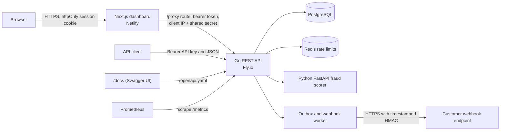

# AegisPay

[](https://github.com/manziosee/AegisPay/actions/workflows/ci.yml)
[](https://github.com/manziosee/AegisPay/actions/workflows/deploy-backend.yml)
[](https://github.com/manziosee/AegisPay/actions/workflows/container-security.yml)
[](https://aegispays.netlify.app/)
[](https://aegispay.fly.dev/docs)


AegisPay is a sandbox-first, multi-tenant payment operations platform for businesses anywhere in the world. It gives finance teams one place for a double-entry ledger, collections and refunds, maker-checker approvals, bank-statement reconciliation, period close, fraud review, signed webhooks, and an audit trail. It works with any ISO 4217 currency, and with any bank or payment provider through bank files and statements.

## Live sandbox

| What | URL |
| --- | --- |
| Business dashboard | <https://aegispays.netlify.app/> |
| REST API | <https://aegispay.fly.dev> |
| Interactive API reference (Swagger UI) | <https://aegispay.fly.dev/docs> |
| OpenAPI document | <https://aegispay.fly.dev/openapi.yaml> |
| Health checks | <https://aegispay.fly.dev/health/live>, <https://aegispay.fly.dev/health/ready> |

Create a sandbox workspace from the dashboard's **Create sandbox account** button, or call `POST /v1/auth/register` directly.

> **Sandbox only.** The ledger records internal platform activity; it does not represent bank-held funds or move money over a real payment network. This repository has no live payment connectors and must not be used to process real funds or cardholder data.

## Contents

- [Architecture](#architecture)
- [Technology and languages](#technology-and-languages)
- [Features](#features)
- [Run locally](#run-locally)
- [Dashboard](#dashboard)
- [Deployment](#deployment)
- [CI/CD](#cicd)
- [Configuration reference](#configuration-reference)
- [API quick start](#api-quick-start)
- [Services and ports](#services-and-ports)
- [Kubernetes development deployment](#kubernetes-development-deployment)
- [Operations](#operations)
- [Security boundary and production work](#security-boundary-and-production-work)
- [Repository layout](#repository-layout)

## Architecture



Docker Compose is the recommended local setup. PostgreSQL, Redis, and Fraud stay on the internal Compose network. The business dashboard includes a public product landing page and a role-aware operations workspace; it proxies authenticated API requests through the same origin. Workflows are sandbox-only and do not connect to live payment providers or move real funds. The Go API applies versioned database migrations at startup in this development setup.

The Kubernetes Kustomize base deploys the same services with single replicas and in-cluster PostgreSQL/Redis. It is a development starting point, not a production cluster design.

## Technology and languages

| Area | Technology |
| --- | --- |
| Main API and background outbox worker | Go 1.27.3, `net/http`, `pgx`, Redis client |
| Fraud scoring service | Python 3.12, FastAPI, Pydantic |
| Data and rate limiting | PostgreSQL 16, Redis 7 |
| API contract and explorer | OpenAPI 3.0.3, Swagger UI |
| Business dashboard | Next.js 16 App Router, React 19, TypeScript, Tailwind CSS v4, shadcn v4 (Radix UI), Motion |
| Dashboard delivery | Netlify adapter, standalone Docker image |
| Local infrastructure | Docker, Docker Compose |
| Cluster manifests | Kubernetes, Kustomize |
| Monitoring and security automation | Prometheus, GitHub Actions, Trivy |
| Other source/configuration languages | SQL migrations, YAML manifests/workflows, POSIX shell scripts |

## Features

- Personal or business workspace registration, sessions, member roles, and seven-day invitations accepted by the invited user account. Invitation tokens are returned once for delivery by the caller; no email service is configured.
- Bcrypt password hashes; opaque, hashed session tokens; SHA-256 hashed API keys shown once; scoped sandbox keys with optional expiration and transactional rotation.
- Optional authenticator-app TOTP MFA with encrypted factor secrets, short-lived single-use login challenges, and password-plus-code verification to disable MFA.
- Tenant-aware PostgreSQL constraints for financial records.
- Double-entry ledger postings for sandbox credits, internal transfers, simulated collection confirmation, and simulated refunds.
- Idempotency keys on financial writes, with response replay for matching retries and conflict detection when a key is reused for another request. The dashboard keeps one key per user action until the API confirms it, so a retry after a dropped connection replays instead of repeating. Keys are kept for `IDEMPOTENCY_RETENTION_HOURS` (default 24).
- Separate-user transfer approval based on per-currency organization thresholds; `TRANSFER_APPROVAL_THRESHOLD_MINOR` remains the fallback when no organization threshold is configured.
- Bank-file workflows for payment requests, multi-review payout registers (exported with spreadsheet-formula escaping), CSV statement imports of up to 10,000 lines matched in bulk, reconciliation that never matches one collection to two statement lines, period close, timed reviewer delegation, and audit evidence. Payout register CSVs are for manual bank-portal entry, not executable payment files; only matching statement evidence confirms settlement.
- Fraud assessments through the FastAPI service, review cases, analyst notes, audit records, and case events.
- JSON reconciliation imports match successful collections by reference and currency, accounting for provider fees when comparing gross collection value with net settlement. Finance operators can resolve exceptions by linking a valid collection or ignoring a line, with a required note, audit event, and webhook notification.
- Outbox event dispatch to HTTPS webhook endpoints. Events are published in batches and delivered by a worker pool (`WEBHOOK_WORKER_CONCURRENCY`, default 16) with a per-endpoint cap so one slow endpoint cannot hold every worker. Signing secrets are encrypted under versioned keys (`ENCRYPTION_KEYS`); deliveries use timestamped HMAC-SHA256 signatures, 12 attempts with jittered exponential backoff over about a day, and blocking of private, carrier-grade NAT and other non-public addresses.
- Organization-scoped audit event search and manual retry for terminally failed webhook deliveries; retries are recorded in the audit log.
- Per-IP protection on registration/login, per-email login limits, five codes per MFA login challenge, and per-credential limits on authenticated API traffic; a credential bucket uses a one-way token hash rather than storing the bearer secret in Redis keys. The client address comes from the TCP peer unless the dashboard presents `TRUSTED_PROXY_SECRET` or the peer is listed in `TRUSTED_PROXY_CIDRS` (for a load balancer that sets `X-Forwarded-For`).
- Members join only through invitations. Only owners can change owner or admin memberships, grant the admin role, or invite admins.
- Closed accounting periods (UTC dates) block ledger postings (credits, collection confirmations, refunds and transfer postings) as well as statement imports.
- Rejecting a transfer requires a reason, which is stored with the decision and in the audit log.
- Per-currency organization policy limits for single transaction size and daily collection/transfer volume, with configurable maker-checker approval thresholds.
- Cursor pagination for customer, account, collection, transfer, invitation, webhook delivery, audit, and transaction report lists.
- Unified transaction reporting across collections, transfers, and refunds, with date/type/status/currency filters, per-currency totals, and JSON or CSV export.
- Redis-backed request limits and Prometheus request counters at `/metrics`.
- A Next.js 16 business workspace with a global `Ctrl/Cmd+K` command palette, work-first overview, transaction report with a detail timeline, maker-checker approvals, a reconciliation matcher with collection search, Aegis Intelligence evaluation and review cases, multi-currency accounts, bank-file receive/send records, webhook delivery evidence with retry, a browser-local routing preview, period close controls, team access, and currency policy settings.
- Self-service in the dashboard for everything the API offers: a workspace switcher (create and switch between business and personal workspaces), customers, collections (create, confirm, cancel, refund), internal transfers, sandbox credits, API keys (scoped, expiring, rotate, revoke), webhook endpoints with a signature-verification snippet, and authenticator-app MFA with a QR code.
- **Risk rules in the payment flow.** Organization rules run on the server before every collection, transfer and payout is recorded. They match on currency, amount range and velocity (counted per customer or per source account). Block refuses the request with the reason. Review opens a case, routes transfers and payouts to approval, and keeps a collection from being confirmed until the case is resolved. A dry-run endpoint and screen show which rules would match.
- **Developer tools.** An event log with payloads and delivery counts, event replay to current endpoints, signed `test.ping` deliveries, and webhook signing-secret rotation.
- **Sessions.** Each user sees their active sessions with device, IP address and last activity, and can sign out one session or every other one.
- **Tamper-evident audit log.** Each audit row stores the SHA-256 of the previous row's hash plus its own content, and the database refuses updates and deletes. `GET /v1/audit-logs/verify` (and **Verify integrity** in the dashboard) recomputes the chain.
- Personal and business workspaces can use bank-file receive/send records without connecting a payment provider. AegisPay is the workflow and evidence layer; each user's bank remains responsible for moving funds.

## Run locally

Requirements: Docker Engine with Compose v2 and OpenSSL.

```sh
./scripts/dev-secrets.sh
docker compose up --build -d
docker compose ps
```

The secret generator creates a new `.env` file with restrictive permissions and refuses to overwrite an existing file. An `.env` created before key versioning and proxy client addresses needs two additions; keep any existing `WEBHOOK_ENCRYPTION_KEY`, because it still decrypts secrets stored under it:

```sh
printf 'ENCRYPTION_KEYS=k1:%s\n' "$(openssl rand -hex 32)" >> .env
printf 'TRUSTED_PROXY_SECRET=%s\n' "$(openssl rand -hex 32)" >> .env
chmod 600 .env
docker compose up --build -d
```

On startup and then hourly, the API re-encrypts stored webhook and MFA secrets with the first key in `ENCRYPTION_KEYS`. To rotate, put a new `id:hex` pair first, keep the old pair until the API logs that no secrets remain under it, then remove the old pair.

Do not commit `.env` or reuse development secrets in a hosted environment. `.env.example` contains placeholders only.

To stop the services while retaining local database data:

```sh
docker compose down
```

To delete the local PostgreSQL and Redis volumes as well:

```sh
docker compose down -v
```

Run the Go API unit tests and the dashboard browser workflows with:

```sh
(cd backend/go && go test ./...)
(cd apps/dashboard && npm ci && npx playwright install chromium && npm run test:e2e)
```

`npm run test:e2e` uses mocked API responses. `npm run test:live` drives a real dashboard and API end to end, with no mocks. It covers sign-up, customers, accounts, collections, refunds, transfers, API keys, webhooks, MFA and workspace switching, and it creates a fresh sandbox workspace on each run:

```sh
cd apps/dashboard
LIVE_BASE_URL=https://aegispays.netlify.app npm run test:live   # deployed sandbox
LIVE_BASE_URL=http://127.0.0.1:3000 npm run test:live           # local stack
```

To develop the dashboard against the deployed API, copy `apps/dashboard/.env.example` to `.env.local`; it points `API_PROXY_TARGET` at `https://aegispay.fly.dev`.

The browser tests use mocked API responses and do not write to the local business database.

## Dashboard

The dashboard is a separate Next.js app in `apps/dashboard`. It serves the public landing page at `/`, authentication at `/login` and `/register`, and the protected workspace under `/app`.

It never calls the Go API cross-origin from the browser. The route handler at `src/app/proxy/[...path]/route.ts` forwards `/proxy/v1/...` to `API_PROXY_TARGET`:

```text
Browser -> /proxy/v1/... -> Next route handler (session cookie -> bearer token) -> Go API /v1/...
```

The session token is stored only in an httpOnly, `SameSite=Strict` cookie (`__Host-` prefixed over HTTPS), so page scripts never see it. The handler rejects cross-site state-changing requests by checking `Origin` and `Sec-Fetch-Site`. `src/proxy.ts` sets a per-request nonce Content-Security-Policy, and `next.config.ts` adds the remaining security headers.

Hosting settings for Netlify, or any other Next.js host, are under [Deployment](#deployment). Don't point `API_PROXY_TARGET` at `localhost` in a hosted deployment, because the hosted server can't reach your workstation. The API's CORS allow-list stays scoped to Swagger UI, because dashboard requests are same-origin through the proxy route.

Local dashboard development:

```sh
cd apps/dashboard
npm ci
npm run dev
# optionally: API_PROXY_TARGET=http://localhost:18080 npm run dev
```

Quality checks:

```sh
cd apps/dashboard
npm run typecheck
npm run build
npm run test:e2e
```

The workspace uses `Ctrl/Cmd+K` for navigation, actions and loaded records. Routing rules are stored in the browser only and are labelled as a preview; no live provider connector exists in this repository.

## Deployment

The hosted sandbox runs the Go API on [Fly.io](https://fly.io) and the dashboard on [Netlify](https://www.netlify.com). Both redeploy automatically when `main` changes; see [CI/CD](#cicd). The steps below are the one-time setup.

### API on Fly.io

The app is configured in [`backend/go/fly.toml`](backend/go/fly.toml) as `aegispay`, in the `cdg` region. One machine always runs, so the webhook worker and the maintenance jobs keep working between requests. Fly checks `/health/ready` every 15 seconds, and database migrations run when the API starts.

1. Create PostgreSQL and Redis. Either Fly's own services or any hosted provider works; you only need two connection URLs.

   ```sh
   cd backend/go
   fly postgres create --name aegispay-db --region cdg   # or: fly mpg create
   fly postgres attach aegispay-db --app aegispay        # sets DATABASE_URL
   fly redis create --name aegispay-redis --region cdg   # prints a redis:// URL (Upstash)
   ```

2. Set the secrets. Generate new values; never reuse local ones.

   ```sh
   fly secrets set --app aegispay \
     REDIS_URL='redis://default:<password>@<host>:6379' \
     AEGIS_API_KEY="aegis_test_$(openssl rand -hex 32)" \
     ENCRYPTION_KEYS="k1:$(openssl rand -hex 32)" \
     TRUSTED_PROXY_SECRET="$(openssl rand -hex 32)"
   ```

   Keep `TRUSTED_PROXY_SECRET` somewhere safe, because the dashboard needs the same value. If you use an external database rather than `fly postgres attach`, also set `DATABASE_URL` (with `sslmode=require`).

3. Deploy the first time by hand, then let CI take over:

   ```sh
   fly deploy
   curl https://aegispay.fly.dev/health/ready
   ```

### Dashboard on Netlify

The root [`netlify.toml`](netlify.toml) builds `apps/dashboard` with `@netlify/plugin-nextjs` and sets `NETLIFY=true` and `NODE_VERSION=24`. Add these under **Site configuration → Environment variables**, then trigger a deploy:

| Variable | Value |
| --- | --- |
| `API_PROXY_TARGET` | `https://aegispay.fly.dev` (no trailing slash, no `/v1`) |
| `TRUSTED_PROXY_SECRET` | The same value you set on Fly |
| `CLIENT_IP_HEADER` | `x-nf-client-connection-ip` |

On other hosts, set `CLIENT_IP_HEADER` to the header your edge writes with the client address (for example `cf-connecting-ip` behind Cloudflare). Alternatively, set `TRUSTED_PROXY_HOPS` to the number of proxies in front of the dashboard that append to `X-Forwarded-For`. If the dashboard is exposed with neither, clients can choose their own forwarded address. Per-email login limits and per-challenge MFA limits still hold in that case, because they don't depend on the client address.

### Docker Compose and Kubernetes

These deploy the whole stack on your own infrastructure; see [Run locally](#run-locally) and [Kubernetes development deployment](#kubernetes-development-deployment).

## CI/CD

| Workflow | Runs on | What it does |
| --- | --- | --- |
| [`ci.yml`](.github/workflows/ci.yml) | Pushes to `main` and pull requests | Go formatting, `go vet`, unit tests and `govulncheck`; the API built and run against real PostgreSQL and Redis with [`scripts/api_integration_test.py`](scripts/api_integration_test.py) (every migration on an empty database, then risk rules, events, sessions and the audit chain); OpenAPI lint; dashboard typecheck, production build and Playwright tests |
| [`deploy-backend.yml`](.github/workflows/deploy-backend.yml) | Pushes to `main` that change `backend/go/**`, or a manual run | Runs the Go tests, deploys to Fly.io with `flyctl deploy --remote-only`, then waits until `/health/ready` and `/openapi.yaml` respond |
| [`live-smoke.yml`](.github/workflows/live-smoke.yml) | Weekly and on demand | Runs `npm run test:live` against the deployed dashboard and API |
| [`container-security.yml`](.github/workflows/container-security.yml) | Pull requests, weekly, and on demand | Builds the API and fraud images and scans them with Trivy for high and critical issues |
| Netlify (Git integration) | Pushes to `main` | Builds and publishes the dashboard |
| [Dependabot](.github/dependabot.yml) | Weekly | Update pull requests for Go modules, npm, pip, GitHub Actions and the API base image |

The deploy workflow needs one repository secret, a Fly deploy token scoped to the `aegispay` app:

```sh
fly tokens create deploy --app aegispay --expiry 8760h | gh secret set FLY_API_TOKEN --repo manziosee/AegisPay
```

Deploys never overlap. A failing test or health check stops the run and leaves the previous release serving traffic. To redeploy without a code change, run the workflow from the **Actions** tab.

## Configuration reference

Settings read by the Go API. Secrets go in `.env` locally, `fly secrets` on Fly.io, or a Kubernetes Secret; the rest are plain environment variables.

| Variable | Required | Purpose |
| --- | --- | --- |
| `DATABASE_URL` | Yes | PostgreSQL connection URL. Migrations run on startup. |
| `REDIS_URL` | Yes | Redis URL for rate limits. |
| `AEGIS_API_KEY` | Yes | Bootstrap operator key for the sandbox organization. Treat it as a root credential. |
| `AEGIS_ORGANIZATION_ID` | Yes | ID of the bootstrap sandbox organization (default in configs: `org_sandbox`). |
| `ENCRYPTION_KEYS` | For webhooks and MFA | Comma-separated `id:hex` keys (32 bytes each). The first encrypts; all decrypt. Old secrets are re-encrypted hourly. |
| `WEBHOOK_ENCRYPTION_KEY` | Legacy | The single key used before `ENCRYPTION_KEYS`. Keep it while older secrets exist. |
| `TRUSTED_PROXY_SECRET` | Recommended | Shared with the dashboard so per-IP limits see browser addresses. At least 32 characters. |
| `TRUSTED_CLIENT_IP_HEADER` | On Fly.io | Edge header holding the client address (`Fly-Client-IP`). Only set it if every request passes through that edge. |
| `TRUSTED_PROXY_CIDRS` | Optional | Load-balancer ranges whose `X-Forwarded-For` is trusted. |
| `HTTP_ADDR` | Optional | Listen address (default `:8080`). |
| `RATE_LIMIT_PER_MINUTE` | Optional | Requests per minute for each authenticated credential (default 600). |
| `REGISTER_LIMIT_PER_HOUR` | Optional | Sign-ups per hour from one client address (default 20). Shared mobile and home networks put many people behind one address. |
| `FRAUD_SERVICE_URL` | Optional | Fraud scorer URL (default `http://fraud:8090`). Without it, risk analysis returns 503. |
| `TRANSFER_APPROVAL_THRESHOLD_MINOR` | Optional | Fallback approval threshold when an organization has no policy. |
| `WEBHOOK_WORKER_CONCURRENCY` / `OUTBOX_BATCH_SIZE` | Optional | Webhook worker pool size (16) and outbox batch size (200). |
| `IDEMPOTENCY_RETENTION_HOURS` / `SESSION_RETENTION_DAYS` / `MAINTENANCE_INTERVAL_MINUTES` | Optional | Retention and cleanup cadence (24 h, 30 days, 60 min). |
| `SWAGGER_ORIGIN` | Optional | Origin allowed by CORS for a separately hosted Swagger UI. |

The dashboard reads `API_PROXY_TARGET`, `TRUSTED_PROXY_SECRET`, `CLIENT_IP_HEADER` and `TRUSTED_PROXY_HOPS`; see [Dashboard on Netlify](#dashboard-on-netlify).

## API quick start

For the hosted sandbox, use `https://aegispay.fly.dev` and try requests from <https://aegispay.fly.dev/docs>. The default local API base URL is `http://localhost:18080`. Set `API_PORT=8080` when launching Compose to use port 8080 instead. Interactive API documentation is at `http://localhost:8081`.
The AegisPay landing page and business dashboard are at `http://localhost:3000`. From the landing page, select **Log in** or **Create sandbox account** to open the workspace authentication flow.

Check readiness and list the bootstrap sandbox organization:

```sh
API=http://localhost:18080
API_KEY=$(sed -n 's/^AEGIS_API_KEY=//p' .env)
curl -fsS "$API/health/ready"
curl -fsS -H "Authorization: Bearer $API_KEY" "$API/v1/organizations"
```

Register a user and organization with `POST /v1/auth/register`, then use the returned `access_token` as a bearer token. Sessions can select one of the user’s organizations with `X-Organization-ID`; membership is checked for the selected organization.

Create a sandbox account with the bootstrap key:

```sh
curl -fsS -X POST "$API/v1/accounts" \
  -H "Authorization: Bearer $API_KEY" \
  -H 'Content-Type: application/json' \
  -d '{"currency":"RWF"}'
```

For sandbox credits, collections, transfers, refunds, transfer approvals, and reconciliation imports, send a unique `Idempotency-Key` header. Amounts are positive integers in the currency’s smallest configured unit. Sandbox credits and confirmations simulate ledger entries; they do not indicate that an external payment occurred.

Full request and response definitions are in [`docs/api/openapi.yaml`](docs/api/openapi.yaml). Swagger UI is served locally on port 8081.

Transaction reporting supports `from`/`to` RFC3339 date bounds, `currency`, `type`, and `status`; JSON responses include grouped totals and use `limit`/`cursor` pagination. Add `format=csv` to download the current page. Reports are explicitly labeled as sandbox ledger activity and do not claim external provider settlement.

API keys can be created with an optional `expires_at`, then atomically rotated with `POST /v1/api-keys/{id}/rotate`; rotation immediately revokes the old key and returns the replacement secret once. `POST /v1/invitations` creates a seven-day invitation and returns a one-time token for secure out-of-band delivery. The invited user signs in, selects the organization with `X-Organization-ID`, and accepts through `POST /v1/invitations/{id}/accept`. `GET /v1/audit-logs` and `GET /v1/webhook-deliveries` support cursor pagination. Failed webhook deliveries can be requeued with `POST /v1/webhook-deliveries/{id}/retry`.

Users can enroll TOTP through `/v1/auth/mfa/enroll`, confirm with `/v1/auth/mfa/verify`, then complete password login with `/v1/auth/mfa/verify-login`. Disabling MFA requires both the password and a current authenticator code. Factor encryption uses `WEBHOOK_ENCRYPTION_KEY`.

## Services and ports

| Service | Local address | Purpose |
| --- | --- | --- |
| Go API | `http://localhost:18080` | REST API and `/health/*`, `/metrics` |
| Business dashboard | `http://localhost:3000` | Business finance and operations workspace |
| Swagger UI | `http://localhost:8081` | Interactive OpenAPI explorer |
| Prometheus | `http://localhost:9090` | Local metrics dashboard |
| PostgreSQL | Compose network only | Persistent application database |
| Redis | Compose network only | Rate-limit store |
| Fraud service | Compose network only at `fraud:8090` | Internal risk scoring API |

Use `docker compose exec postgres psql` or `docker compose exec redis sh -c 'redis-cli -a "$REDIS_PASSWORD"'` for local data-service administration. PostgreSQL and Redis are not published on host ports.

## Kubernetes development deployment

`infrastructure/kubernetes/base` is a Kustomize development base. It includes API, Fraud, Swagger UI, PostgreSQL, Redis, Prometheus, NetworkPolicy examples, and development secrets wiring. It expects a default StorageClass and a Secret named `aegispay-secrets`.

Create the namespace and secret, build/load the images, then apply the manifests:

```sh
kubectl create namespace aegispay
kubectl -n aegispay create secret generic aegispay-secrets \
  --from-literal=POSTGRES_PASSWORD="$(openssl rand -hex 32)" \
  --from-literal=APP_DB_PASSWORD="$(openssl rand -hex 32)" \
  --from-literal=REDIS_PASSWORD="$(openssl rand -hex 32)" \
  --from-literal=AEGIS_API_KEY="aegis_test_$(openssl rand -hex 32)" \
  --from-literal=WEBHOOK_ENCRYPTION_KEY="$(openssl rand -hex 32)"
docker build -t aegispay-api:local ./backend/go
docker build -t aegispay-fraud:local ./backend/python/fraud
kind load docker-image aegispay-api:local aegispay-fraud:local
kubectl apply -k infrastructure/kubernetes/base
```

For Minikube, load the images with `minikube image load aegispay-api:local` and `minikube image load aegispay-fraud:local`. Forward services to your workstation:

```sh
kubectl -n aegispay port-forward svc/api 18080:8080
kubectl -n aegispay port-forward svc/swagger 8081:8080
kubectl -n aegispay port-forward svc/prometheus 9090:9090
```

Kubernetes Secret values are base64 encoded, not encrypted by default. Enable cluster secret encryption and suitable RBAC or an external secrets manager before using a hosted cluster. NetworkPolicies work only when the cluster CNI enforces them.

## Operations

- Back up the local database with [`scripts/backup-postgres.sh`](scripts/backup-postgres.sh).
- Restore an archive into a separate database with [`scripts/restore-postgres-to-new-db.sh`](scripts/restore-postgres-to-new-db.sh); the script leaves the active database unchanged.
- Local backups are compressed but not encrypted. Configure production encryption, retention, access controls, and recurring restore drills in the hosting environment.
- GitHub Actions builds the Go and Fraud images and scans them with Trivy for high and critical vulnerabilities, secrets, and misconfiguration.

## Security boundary and production work

The bootstrap key in `.env` is a privileged local sandbox operator credential. Normal user roles and API-key scopes restrict access. Webhooks require HTTPS and reject DNS resolutions to private, local, link-local, or other non-public addresses. These controls are useful for local development; they do not by themselves constitute a production security program.

A production payment platform still needs authorized bank/mobile-money partners, provider callbacks and settlement/reversal handling, and jurisdiction-specific approvals. The repository does not have live collection or payout integrations. Production deployment also needs a managed identity provider with MFA and recovery, invitation flows, tenant row-level security, access reviews, a separate migration job and database role, TLS and private managed data services, managed secrets, encrypted backups and restore drills, monitoring and alerts, incident response, and environment-isolated CI/CD. Do not store raw card data.

## Repository layout

```text
backend/
  go/                         Go REST API, migrations, Docker image, fly.toml
  python/fraud/               FastAPI risk scorer and Docker image
apps/
  dashboard/                  Next.js business operations dashboard
docs/
  api/openapi.yaml             OpenAPI contract
  INFRASTRUCTURE.md            Deployment and operations notes
infrastructure/
  kubernetes/base/             Kustomize development manifests
  monitoring/prometheus/       Prometheus scrape configuration
  postgres/init/               Least-privilege local database bootstrap
scripts/                       Secret generation and backup/restore helpers
.github/workflows/             CI, Fly.io API deploy, container security scan
compose.yaml                   Local multi-service development stack
```
